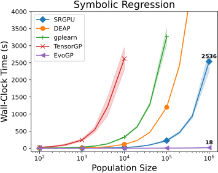
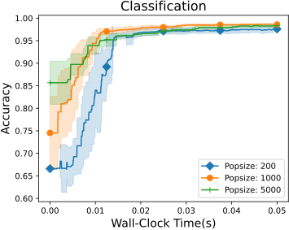
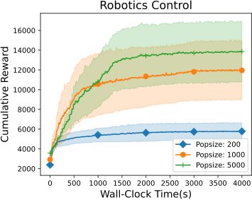
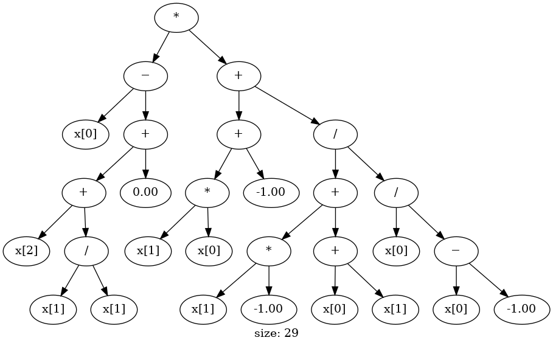
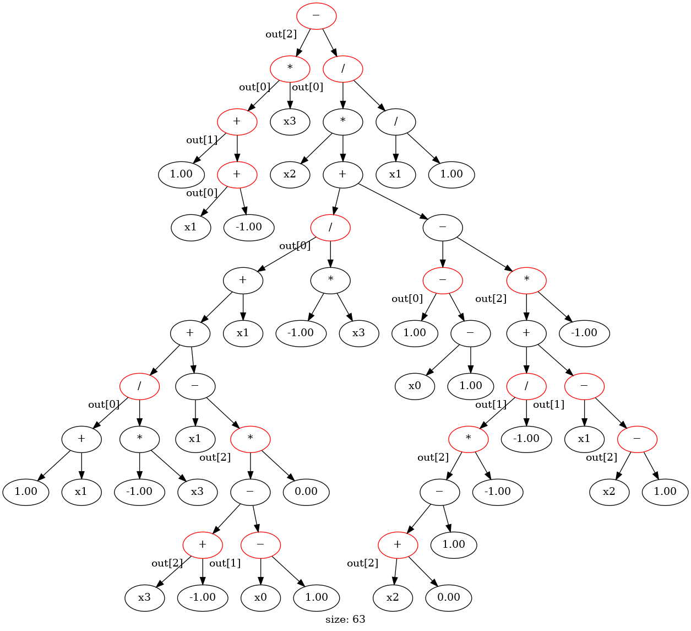

<h1 align="center">
  <a href="https://github.com/EMI-Group/evox">
  <picture>
    <source media="(prefers-color-scheme: dark)" srcset="./imgs/evox_brand_light.svg">
    <source media="(prefers-color-scheme: light)" srcset="./imgs/evox_brand_dark.svg">
    
  </picture>
  </a>
  <br>
</h1>

<p align="center">
  <picture>
    
  </picture>
  <picture>
    
  </picture>
  <picture>
    
  </picture>
</p>


<p align="center">
🌟 EvoGP: Tree-based Genetic Programming, JIT-compiled through EvoX Compiler — torch-native and torch-free stacks 🌟
</p>

<p align="center">
  <a href="https://arxiv.org/abs/2501.17168">
    
  </a>
</p>

## Table of Contents
- [Introduction](#introduction)
- [Key Features](#key-features)
- [Installation](#installation)
- [Quick Start](#quick-start)
- [Evaluation Routes & Performance](#evaluation-routes--performance)
- [Functional GP Stack (`evogp.gp`)](#functional-gp-stack-evogpgp)
- [Advanced Genetic Operations](#advanced-genetic-operations)
- [Supported Benchmarks](#supported-benchmarks)
   - [Symbolic Regression](#symbolic-regression)
   - [Classification](#classification)
   - [Transformation](#transformation)
   - [Robotics Control](#robotics-control)
- [Validation](#validation)
- [Experiments in Paper](#experiments-in-paper)
- [Citation](#citation)
- [Community & Support](#community--support)
- [Future Work](#future-work)
- [Acknowledgements](#acknowledgements)


## Introduction

EvoGP is a **tree-based genetic programming** (TGP) framework in pure Python with two stacks over one shared
evaluation engine:

- the **torch-native stack** (`evogp.tree`, `evogp.algorithm`, `evogp.problem`, `evogp.pipeline`): an individual is
  just a few ordinary tensors — a population is three parallel `[pop_size, max_tree_len]` matrices holding
  prefix-encoded trees — so random tree generation, crossover and mutation are plain vectorized torch operations and
  a whole generation moves through the GPU as one batch. It is also the numeric oracle and the benchmark baseline.
- the **functional stack** (`evogp.gp`, new in 2.0.0a1): the same GP algorithm written as Evox-2.0-style plain
  functions — frozen config dataclasses, `evoxc` tensor state, `init_gp` / `step` / `run` — with **no torch
  dependency at all** (see [Functional GP Stack](#functional-gp-stack-evogpgp)).

Everything is evaluated through **EvoX Compiler** (`evoxc`), the compiler and runtime EvoX 2.0 is built on, and tree
evaluation is a **"true jit"**: `evogp.tree` decodes trees host-side into int-only static programs, hands them to
evoxc as graphs (or, on the fused route, to a fused Triton kernel) and caches what it compiled, keyed by *(tree
structure or population shape, input shape, backend, device, options)*. A structure, or a population shape, is
therefore compiled **once** and re-evaluated as a cache hit: elites, duplicated individuals and the same population in
the next generation never pay the compile cost twice.
No in-graph dispatch, no recursion — the tree *is* the graph.

Four evaluation routes are selectable with `EVOGP_EVAL_MODE`: **`fused`** (one fused Triton kernel launch for the whole
population — the fastest route we have measured, 80–229× the plain-torch batched evaluator on the shipped default, above
the 41–157× of the forced-route column measured in an earlier session), **`dense`** (one all-ops
compiled graph per population shape), **`specialized`** (one compiled graph per tree structure) and **`batch`** (one
merged graph per population structure multiset, opt-in). `auto` — the default — takes **`fused` first** on a device box
(from `EVOGP_FUSED_MIN_POP` = 16 up, while Triton is importable and the call fits the fused memory envelope), then
`dense`+`iree` at population ≥ 64, and `specialized`+`numpy` everywhere else; it never picks `batch`.
The full table, numbers and knobs are in [Evaluation Routes & Performance](#evaluation-routes--performance).

There are **no custom CUDA/HIP kernels and no build step**: EvoGP is pure Python on top of `evoxc`, `numpy` and
(optionally) `torch`. `pip install .` compiles nothing, `import evogp.tree` works straight from a checkout (`src/` on
the import path), and the only hard engine requirement is that `evoxc` is importable. The fused route JIT-compiles its
Triton kernels at the **first call** (≈1.6 s for the value kernel, ≈2.9 s for all three surfaces, once per
specialization per machine) rather than at install time.

EvoGP supports multi-output trees and ships task layers for symbolic regression, classification, feature
transformation and robotics control (Brax / MuJoCo-Playground / Genesis), together with a library of interchangeable
crossover / mutation / selection operators.

**Release line.** EvoGP **2.0.0a1** is the release aligned with the **EvoX 2.0 pre-release (`evox` 2.0.0a1)**, a
from-scratch functional rewrite of EvoX on `evoxc`: same dependency, same idiom (`evogp.gp` follows it directly).
EvoGP stays a sister project of <a href="https://github.com/EMI-Group/evox">EvoX</a> — EvoX 2.0 has no
tree/GP/symbolic-regression component, so that part is EvoGP's contribution to the family.

## Key Features

- **"True jit" evaluation through evoxc, four ways**:

    - Every tree structure is decoded host-side into an int-only static program, compiled once into an evoxc graph and cached per structure — so the population-scale cost is dominated by *new* structures, not by generations. The `dense`, `batch` and `fused` routes instead compile **one graph per population shape** (or launch one fused Triton kernel), so a GP loop pays no per-generation compile at all.
    - The same programs run on any evoxc backend: the CPU reference interpreter (`numpy`, default) or a compiled backend (IREE), chosen per process with environment variables or per call. The `fused` route runs on the torch device through Triton and needs no evoxc backend.

- **A fused Triton route that removes the dispatch bound**:

    - `EVOGP_EVAL_MODE=fused` launches **one fused kernel for the whole population**, reading the tree channels directly, with no per-node dispatch, no graph and no readback: **0.0449–0.1152 ms against 3.954–26.364 ms** for the plain-torch batched evaluator across the six benchmark cells on the shipped default (**80.2×–228.9×**, 60.2×–208.8× on the loss surface).
    - Value outputs are bit-identical to the plain-torch oracle on every measured cell; evaluation is 14.2–15.4 % of a GP generation, so the operator layer is the bottleneck. It is `auto`'s first choice on a device box, and `EVOGP_EVAL_MODE=fused` forces it anywhere.

- **Two stacks, one engine**:

    - `evogp.tree` / `algorithm` / `problem` / `pipeline` is the torch-native stack (also the numeric oracle and the benchmark baseline).
    - `evogp.gp` is the **torch-free functional stack** in the EvoX 2.0 idiom: frozen config dataclasses, `evoxc` tensor state, `init_gp` / `step` / `run`, numpy host glue — `import evogp.gp` needs neither torch nor a GPU.

- **Tensor-native GP loop**:

    - Population, generation, mutation and crossover are batched torch tensor operations; there is no per-individual Python loop on the hot path.
    - Determinism comes from torch's global RNG: seed with `torch.random.manual_seed(...)` / `torch.cuda.manual_seed(...)` and a run is reproducible. The functional stack is key-based instead (`run(..., key=0)`), with no global seed.

- **No build step, no toolchain**:

    - Installation is `pip install .` — no CUDA Toolkit, no ROCm, no `nvcc`/`hipcc`, no C++ compiler, no extension to rebuild after an edit.
    - The evoxc evaluation engine is device-agnostic and reads population tensors back host-side; the default backend needs no GPU at all. The fused route's Triton kernels are JIT-compiled on first use.

- **Rich in extended content**:

    - Offers a range of genetic operation variants, allowing users to tailor configurations for specific tasks.
    - Supports multi-output trees, making it suitable for complex problems like classification and policy optimization.
    - Supports Symbolic Regression, Classification, Transformation and Policy Optimization (Brax) benchmarks.

- **Inspectable results**:

    - The best tree exports to a sympy expression (`Tree.to_sympy_expr`), to an infix string (`Tree.to_infix`) and to an image (`Tree.to_png`).

## Installation

**Requirements:** Python >= 3.11. Installing EvoGP pulls its runtime core — **`evoxc` (EvoX Compiler)**, the
evaluation engine every route runs on, and **`evox>=2.0.0a1`**, the functional framework this release line aligns with
— plus `numpy`, `scikit_learn`, `networkx` and `sympy`.
**`torch` is optional** (`evogp[torch]`): it is needed by the torch-native stack (`evogp.tree` / `algorithm` /
`problem` / `pipeline`) and by the fused route, while the functional stack (`evogp.gp`) runs on `evoxc` + numpy alone.
A **CUDA Toolkit / ROCm / C++ compiler is not required** — nothing is compiled at install time. (The fused route
JIT-compiles its Triton kernels on the first call, which needs `triton` and a CUDA-visible device, AMD GPUs under
ROCm included.)

### 1. Install EvoGP

```bash
pip install git+https://github.com/EMI-Group/evogp.git
# or, from a local checkout:
pip install .
```

There is no build step: the command installs Python code only — no compiler, no CUDA/ROCm toolchain, no extension.

`evoxc` and `evox` are ordinary PyPI dependencies of EvoGP. For a development setup on the sibling checkouts,
install them from source instead — `pip install /path/to/evoxc` (the compiler), and the **pre-release** EvoX 2.0 line,
which PyPI only serves behind `--pre` because `evox` 2.0 and 1.x share the distribution name:

```bash
pip install --pre "evox>=2.0.0a1"     # or: pip install /path/to/evox
```

`evox` 2.0 and the stable `evox` 1.x line cannot coexist in one environment; install the 2.0 line in its own venv if
you also use 1.x.

### 2. Optional extras

```bash
pip install "evogp[torch]"       # the torch-native stack, the numeric oracle and the benchmark baseline
pip install "evogp[fused]"       # torch + triton, for the fused evaluation route (needs a CUDA-visible device)
pip install "evogp[iree]"        # compiled (IREE) backends, for GPU execution of the generated evoxc graphs
pip install "evogp[visualize]"   # pygraphviz, needed by Tree.to_png (also needs the Graphviz `dot` binary)
pip install "evogp[brax]"        # jax + brax, needed by the Brax robotics-control problem
pip install "evogp[dev]"         # pytest, needed to run the test suites
```

From a source checkout, use `pip install ".[torch]"` and so on; extras can be combined
(`pip install "evogp[fused,visualize]"`). EvoGP also works **without installation** from a checkout of this
repository by putting `src/` on the import path (`PYTHONPATH=src`), which is how the examples and tests below are run.

### 3. Validate the installation

```bash
python -m evogp.sr_test               # torch stack on the default `auto` = fused route, ~11 s
python -m evogp.gp.smoke              # functional stack, torch-free, ~4 s
```

See [Validation](#validation) for what these run and how to size them.

## Quick Start

The canonical flow of the **torch-native stack** (needs the `[torch]` extra) — identical to
[`example/basic.py`](example/basic.py), a small symbolic-regression run on the 8-row XOR-3d problem. Run it from the
repository root (`python example/basic.py`, or `PYTHONPATH=src python example/basic.py` from an uninstalled checkout).
For the torch-free flow of the functional stack, see [Functional GP Stack](#functional-gp-stack-evogpgp).

1. **Import the modules**:

```python
import torch
from evogp.tree import Forest, GenerateDescriptor
from evogp.algorithm import (
    GeneticProgramming,
    DefaultSelection,
    DefaultMutation,
    DefaultCrossover,
)
from evogp.problem import SymbolicRegression
from evogp.pipeline import StandardPipeline
```

2. **Define a problem** (here: symbolic regression on XOR-3d):

```python
XOR_INPUTS = torch.tensor(
    [
        [0, 0, 0],
        [0, 0, 1],
        [0, 1, 0],
        [0, 1, 1],
        [1, 0, 0],
        [1, 0, 1],
        [1, 1, 0],
        [1, 1, 1],
    ],
    dtype=torch.float,
    device="cuda",
)

XOR_OUTPUTS = torch.tensor(
    [[0], [1], [1], [0], [1], [0], [0], [1]],
    dtype=torch.float,
    device="cuda",
)

problem = SymbolicRegression(datapoints=XOR_INPUTS, labels=XOR_OUTPUTS)
```

3. **Configure the algorithm**:

```python
# create descriptor for generating new trees
descriptor = GenerateDescriptor(
    max_tree_len=64,
    input_len=problem.problem_dim,
    output_len=problem.solution_dim,
    using_funcs=["+", "-", "*", "/"],
    max_layer_cnt=5,
    const_samples=[-1, 0, 1],
)

# create the algorithm
algorithm = GeneticProgramming(
    initial_forest=Forest.random_generate(pop_size=50, descriptor=descriptor),
    crossover=DefaultCrossover(),
    mutation=DefaultMutation(
        mutation_rate=0.2, descriptor=descriptor.update(max_layer_cnt=3)
    ),
    selection=DefaultSelection(survival_rate=0.3, elite_rate=0.01),
    enable_pareto_front=True,
)
```

4. **Run!**:

```python
pipeline = StandardPipeline(
    algorithm,
    problem,
    generation_limit=100,
)

best = pipeline.run()
```

5. **Check the details of the best tree**:

```python
# predictions on the training data (best is a Tree)
pred_res = best.forward(XOR_INPUTS)
print(pred_res)

# the symbolic formula of the best tree
sympy_expression = best.to_sympy_expr()
print(sympy_expression)

# the non-dominated front, when enable_pareto_front=True
print(algorithm.pareto_front)
```

6. **Visualize** (optional, requires the `[visualize]` extra and the Graphviz `dot` binary):

```python
best.to_png("./imgs/xor_tree.png")
```

Every structure encountered during the run is compiled once and then served from the evoxc compile cache, so
`best.forward(...)` after `pipeline.run()` is a cache hit for the structure/shape combination the run already built
(`EVOGP_EVOXC_CACHE_SIZE` defaults to 4096 entries, one per *(structure, shape, backend, device, options)*).

The complete, runnable script is [`example/basic.py`](example/basic.py) (it leaves the `to_png` call commented out so
that it writes nothing to disk); more end-to-end scripts live in [`example/`](example).

The demo is a wiring example, not a tuned search: the XOR-3d target is a hard one for the small `pop_size=50`,
100-generation budget above, so a run may plateau (for example at a constant such as `0.5`). Raise `pop_size` /
`generation_limit`, or start from [`example/regressor.py`](example/regressor.py), for a real search.

**Note on devices:** the tensor representation, the algorithm layer and the problem layer of the torch-native stack
create their tensors on `"cuda"` (the same string also selects AMD GPUs under ROCm) and tensors are relocated there on
use, so an end-to-end run of that stack expects a CUDA-visible device — even though the default evaluation backend
computes on the CPU. The evoxc engine itself is device-agnostic (it accepts population/input tensors from any device
and returns results on the input's device), and on a device box the `fused` route is what turns that device into
speed: one kernel launch per population, 80×–229× the plain-torch batched evaluator on the shipped default
(8.6×–663× the `dense` default of the pre-fused window, a lower bound now). The functional stack (`evogp.gp`) needs no
device at all.

## Evaluation Routes & Performance

Tree evaluation is JIT-compiled and cached; the **route** decides *what* is compiled (one graph per tree structure,
one all-ops graph per population shape, one merged graph per population, or no graph at all) and *where* it runs.
`EVOGP_EVAL_MODE` selects it, `auto` is the default policy:

| Route | Enabled by | What runs | Compile cost | Warm cost (measured, whole population) |
|---|---|---|---|---|
| **`fused`** — what `auto` picks first on any CUDA-visible device | `auto` (default) on a device box, or force it with `EVOGP_EVAL_MODE=fused`; `pip install "evogp[fused]"` | ONE fused Triton kernel launch for the whole population, on the torch device; the tree channels are read directly, there is no evoxc graph, no per-node dispatch and no readback | one-time Triton JIT per kernel specialization: ~1.64–1.67 s value, ~0.94–0.99 s loss, ~0.32 s per-row from an empty cache (~2 ms from a warm disk cache) | **0.0449–0.1152 ms** |
| `dense` — what `auto` picks on a device box at population ≥ 64 when the fused route is unavailable | `EVOGP_EVAL_MODE=dense` (alias `dynamic`) | one all-ops compiled graph per population shape: every candidate op is emitted once and the tree structure stays runtime data | 3.1–3.4 s (L=32) / ~6.1 s (L=64) per (shape, function set) on IREE; ~0.16 s from the opt-in artifact cache | 2.0–111 ms |
| `specialized` — what `auto` picks everywhere else, and every fallback | `EVOGP_EVAL_MODE=specialized` | one compiled graph per tree structure (`evoxc.build_cached`) | 1–10 ms per structure on `numpy`, ~0.4–0.9 s on IREE | ~0.5 ms per tree (numpy), ~2.4–3.6 ms per tree (IREE) |
| `batch` — opt-in | `EVOGP_EVAL_MODE=batch` | ONE merged graph for the whole population, built with evoxc's `batch_functions` transform | 2.7–164 s per merged plan (chunked; superlinear in the population's total node count) | 3.4–6.9 ms |

**Where `auto` goes.** On a device box `auto` takes the **`fused`** route FIRST, from `EVOGP_FUSED_MIN_POP` (16) up,
while `triton` is importable and the call fits the fused memory envelope (`EVOGP_FUSED_MAX_SCRATCH_MB`); with no Triton
or above that envelope it takes `dense`+`iree` at population ≥ 64; below that threshold, on a CPU box and on every
fallback it takes `specialized`+`numpy`, because a per-shape or per-structure compile cannot amortize there. `auto`
never selects `batch`, and `EVOGP_EVAL_MODE` overrides the whole policy for any single route.

### Performance summary — what the joint optimization achieved (2.0.0a1)

Every number below is a warm median from a committed record, and each claim names the file it comes from; this is the
one-screen summary, the per-cell tables and the reproduce blocks are further down.

- **Four routes, one default.** `auto` takes `fused` first on any CUDA-visible device, `dense`+`iree` at population ≥ 64
  when it cannot, and `specialized`+`numpy` everywhere else; `batch` stays opt-in (table above).
- **A whole population in one call:** `Forest.batch_forward` reads **0.0449–0.1152 ms** against **3.954–26.364 ms** for the
  plain-PyTorch batched evaluator — **80.2×–228.9×** (per-cell table under *Headline* below; the records are
  [`test/benchmark/evoxc/results/t1a1_auto_r3/README.md`](test/benchmark/evoxc/results/t1a1_auto_r3/README.md) §2).
- **The loss and per-row surfaces agree:** `SR_fitness` **0.0572–0.1262 ms** (**60.2×–208.8×**) and `forward`
  **0.0390–0.0722 ms** (**85.8×–220.1×**) on the same records.
- **A whole GP generation:** **2.841–3.282 ms**, of which evaluation is **0.433–0.471 ms (14.2–15.4 %)** — **7.7×–99.8×**
  the batched torch arm, with the operator layer (2.404–2.815 ms) as the loop's bottleneck (same file, §7).
- **The round measured on the release tree:** the code-vs-code figure is the same-session `--tree-root` A/B against the
  pre-round tree `5a699ca` — **1.31×–1.77×** on `batch_forward`, 1.34×–1.65× on `SR_fitness` and 1.55×–1.97× on
  `forward`, unchanged on the generation (`gp_step` 0.968–1.140) — because on a sub-0.12 ms call the cross-window ratio
  is mostly window drift (a code-identical control reads 0.951–1.118; same file §4–§5, §8).
- **Where a warm call goes now:** the prepared call is memoized (`fused_engine.PLAN_MEMO`), the launch is pre-bound
  (`EVOGP_FUSED_DISPATCH=bound` serves Triton 3.7.1's `CompiledKernel.run` launcher, `jit` restores
  `JITFunction.run`), a single-slot plan fast path serves a repeated population and the route decision is memoized
  (`route_cache_stats()`, `resolve_route` 5.845 → 1.273 µs) — the kernel is **88–96 %** of a warm call
  ([`src/evogp/tree/FUSED.md`](src/evogp/tree/FUSED.md) §18–§19).
- **Cold start is one Triton JIT, never one compile per shape:** 1.64–1.67 s for the value kernel, 0.94–0.99 s for the
  loss kernel and 0.32 s for the per-row surface from an empty cache, ~2 ms from a warm disk cache
  ([`src/evogp/tree/FUSED.md`](src/evogp/tree/FUSED.md) §5).
- **The torch-free stack carries the same evaluation into a whole loop:** ≈1.1–1.4 ms per generation device-resident,
  **4.2×–17.1×** the torch stack's `StandardPipeline.step` and **2.0×–2.2×** the torch stack on its own `fused` route
  ([`src/evogp/gp/DEVICE_LOOP.md`](src/evogp/gp/DEVICE_LOOP.md) §1–§2).
- **The speed is value-exact on the value surfaces:** bitwise against `torch-batched` on the arithmetic and ternary
  function sets (`max_abs = 0.0` on every finite point), differing only in NaN payload bits elsewhere, with losses
  **≤3.8e-7 relative** ([`src/evogp/tree/FUSED.md`](src/evogp/tree/FUSED.md) §6 and
  [`test/benchmark/evoxc/VALIDATION.md`](test/benchmark/evoxc/VALIDATION.md)).
- **What the joint effort bought the primary metric:** the shipped default (`auto` → `fused`) is **80×–229×** faster than
  the plain-PyTorch batched evaluation (**96×–250×** on the `fused_check` timing column) and value-bitwise on the
  arithmetic and ternary function sets — records, gates and caveats in
  [`test/benchmark/evoxc/results/t1a1_auto_r3/README.md`](test/benchmark/evoxc/results/t1a1_auto_r3/README.md).

### Headline: the shipped default (`auto` → `fused`)

Warm medians, one process per config, `Forest.batch_forward` (one whole population, value surface), N=1024 unless
stated; `torch-batched` is the plain-PyTorch batched evaluator of the benchmark harness. The shipped-default column is
`evoxc-auto` as re-measured in
[`test/benchmark/evoxc/results/t1a1_auto_r3/`](test/benchmark/evoxc/results/t1a1_auto_r3/README.md) (the record of
record is that file — `results/t1a1_auto/README.md` is the verdict page that quotes it and keeps the pre-change
records), with no `EVOGP_EVAL_MODE` and no `EVOGP_EVOXC_BACKEND` exported, i.e. exactly what a plain install does
(design and route semantics in [`src/evogp/tree/FUSED.md`](src/evogp/tree/FUSED.md)); the last column is the previous
round's committed medians (`results/t1a1_auto_r2/`):

| cell (pop × tree length × inputs × rows) | `auto` (shipped default) | `torch-batched` | speed-up | previous round `auto` |
|---|---|---|---|---|
| `p256-L32-i8-N1024` | **0.0493 ms** | 3.954 ms | **80.2×** | 0.0861 ms |
| `p256-L64-i32-N1024` | **0.0449 ms** | 4.869 ms | **108.4×** | 0.0780 ms |
| `p256-L64-i32-N4096` | **0.0522 ms** | 5.020 ms | **96.2×** | 0.0849 ms |
| `p1000-L64-i32-N1024` | **0.0500 ms** | 4.841 ms | **96.8×** | 0.0947 ms |
| `p4096-L64-i32-N1024` | **0.0790 ms** | 10.415 ms | **131.8×** | 0.1257 ms |
| `p2048-L128-i32-N1024-d7` (123-node trees) | **0.1152 ms** | 26.364 ms | **228.9×** | 0.1460 ms |

On the loss surface (`Forest.SR_fitness`) the shipped default reads 0.0572–0.1262 ms, i.e. **60.2×–208.8×** the batched
arm, and 0.0390–0.0722 ms on `forward` (85.8×–220.1×). Read the headline as **80×–229× the plain-PyTorch batched
evaluator on `batch_forward`** (0.045–0.115 ms against 3.95–26.36 ms; 60×–209× on the loss surface), with a one-time
~1.6 s Triton JIT and no per-shape compile.
The last column is the previous round's committed window; the round is quoted as a same-session `--tree-root` A/B against
that round's tree (`5a699ca`) instead of as a cross-window ratio, which reads **1.31×–1.77×** on `batch_forward`,
1.34×–1.65× on `SR_fitness` and 1.55×–1.97× on `forward`
([`test/benchmark/evoxc/results/t1a1_auto_r3/README.md`](test/benchmark/evoxc/results/t1a1_auto_r3/README.md) §4–§5,
§8).

**The same route forced.** With `EVOGP_EVAL_MODE=fused` the route is stated instead of resolved per call; that column —
measured in its own session, BEFORE the host-glue round
([`test/benchmark/evoxc/results/t1a1_fused/`](test/benchmark/evoxc/results/t1a1_fused/README.md)) — reads
0.0995–0.1673 ms on `batch_forward` (**40.8×–156.9×** the batched arm), 0.1299–0.2005 ms on `sr_fitness`
(32.1×–130.9×), and **8.6×–663× the `dense` default** on the wider grid (16.3×–495× at the 12-cell envelope).
It is no longer the ceiling: the shipped default postdates it and is faster at every cell (0.0449–0.1152 ms against
0.0995–0.1673 ms), because the route spelling never changed the warm cost — only the policy decides which route runs.
Neither column loses a measured cell on any axis.

What that does to a GP loop (one `step()` per sample, population replaced every generation): a generation on the
shipped default is **2.841–3.282 ms**, of which evaluation is **0.433–0.471 ms (14.2–15.4 %)** — 7.7×–99.8× faster per
generation than the batched torch arm — with **0 compiles and 0 re-preps** (`gp_step.compile_misses_total` is 0 on
every shipped-default record): a changed population changes only the node tensors the kernel reads.
The operator layer is therefore the loop's bottleneck, and the round cut the repeated-population call rather than the
loop: a fresh population misses the plan fast path every generation, so the generation is unchanged against the
previous round's tree in the same-session A/B (`gp_step` 0.968–1.140, its evaluation slice 1.010–1.156).

Honest limits, from these campaigns:

- **Single-output-first kernel.** The value path folds the reduction in registers for `output_len == 1` and moves only
  `1/rows` of the traffic; `output_len ≥ 2` is served (up to `MAX_OUT_LEN` = 8) but materializes the
  `(pop, rows, out_len)` prediction buffer, so it costs more traffic than the single-output path.
- **The tree walk repeats once per row block and per-program work scales with population**: 0.0449 → 0.0522 ms for 4×
  the rows (+16 %), and 0.0449 / 0.0500 / 0.0790 ms at pop 256 / 1 000 / 4 096 on the same tree length (+11 %, +76 %).
- **The host glue no longer decomposes.** The previous round's split put the kernel at **88–96 %** of a warm call
  (0.061/0.003 … 0.129/0.011 ms kernel/host, [`src/evogp/tree/FUSED.md`](src/evogp/tree/FUSED.md) §3), and with the
  pre-bound launch plus the plan fast path the whole call now reads cheaper than one independently timed launch
  (0.038–0.108 ms against 0.086–0.137 ms), so the stage subtraction goes negative and only the totals are quotable.
- **One-time JIT, not per generation**: ~1.64–1.67 s for the value kernel, ~0.94–0.99 s for the loss kernel, ~0.32 s
  for the per-row surface from an empty Triton cache. `TRITON_CACHE_DIR` must point at a writable directory — on a box
  with a read-only `$HOME` the first launch dies with `OSError: [Errno 30] Read-only file system: '/root/.triton'`,
  and nothing in `src/` sets it.
- **`EVOGP_FUSED_MIN_POP` = 16** keeps a single-tree call (`pop 1`) on the specialized engine so a one-shot
  `Tree.forward` never pays the JIT; `0` is refused. `EVOGP_EVOXC_BACKEND=numpy` still *reports* `engine="fused"` while
  every call declines onto specialized+`numpy`, so a served call must be proven by `fused_cache_stats()`
  (`fused_kernel_launches`), never by the engine name.
- **No per-stage timer surface** on this route: the kernel/host split was reconstructed by timing the kernel launch and
  the facade separately (`fused_check._stage_split`), which the fast path has since made ambiguous (above).
- **Small rows at small trees are unmeasured** (`rows ≤ 64` with 8–32-node trees, pops 1–8), where the kernel's
  ~0.09 ms launch floor is the whole call.

### The evoxc routes: compile once, then cache

The evoxc **backend** (`numpy` or `iree`) decides *where* the generated graph runs; the `dense`, `specialized` and
`batch` routes all run on it.

| Backend | Enabled by | Runs on | Build cost per tree structure | Run cost |
|---|---|---|---|---|
| `numpy` (the default on a CPU box, and below the dense threshold) | nothing to do (explicitly: `EVOGP_EVOXC_BACKEND=numpy`) | CPU, evoxc's reference interpreter | ~1–10 ms | ~0.5 ms per tree (N=100–1000, ~30–43-node trees) |
| `iree` (the default on a device box at population ≥ 64) | `pip install "evogp[iree]"` and `EVOGP_EVOXC_BACKEND=iree` | a GPU device through IREE (the compile target follows the evoxc `Device` kind: `cuda` on CUDA boxes, `rocm` on ROCm boxes) | ~0.4 s (up to ~0.9 s depending on opt level / tracing metadata) | ~2.4–3.6 ms per tree, device-resident |

**Caching economics — compile once per structure.** The engine pays a *build* the first time it sees a given
*(tree structure, input shape, backend, device, options)* pair and a cache-hit lookup (~0.45 ms) every time afterwards.
Measured on the reference box with the `numpy` backend and `EVOXC_DISABLE_LOCATIONS=1`:

- 30–43-node trees: **9.9 ms cold build**, **0.46 ms** warm run per tree at N=100 (0.49 ms at N=1000); a `build_cached` hit costs 0.45 ms.
- That is ~102 distinct builds per second, so a fresh random population of 1000 all-distinct trees costs ~10 s to build, ~5.4 s at 50% duplicates, and only ~0.5 s once everything is cached. Population decoding on top of that is ~10 ms at pop=200 and ~48 ms at pop=1000.
- Consequently the **numpy backend is the right choice at population scale on the per-structure route**, where almost every individual is a new structure and the build dominates.
- **IREE is for repeated structures and heavy per-run work**: the same trees evaluated again and again (elites, repeated rows, long inner loops over many data batches), where the ~0.4–0.9 s per-structure compile is amortized and the computation executes on the device. On the per-structure route, building a fresh random population with IREE is impractical (one compile per individual) and at small batch sizes the numpy interpreter's ~0.5 ms per run beats IREE's ~2.4–3.6 ms (fixed launch/readback overhead) — the `dense` route removes both problems for same-shaped populations.
- The cache is **in-memory only** (nothing is shared between processes) and holds one entry per *(structure, shape, backend, device, options)*; size it at `>= pop_size + headroom` because every distinct structure of a full-population fitness pass needs its own entry. Each entry pins a loaded executable (~270 KiB for a 30-node tree, ~478 KiB for a 60-node tree).
- **Same-shaped populations go through ONE dense graph.** With `EVOGP_EVAL_MODE=dense` (and with `auto` on a device box whenever the fused route is unavailable — no Triton, or a call above the fused memory envelope), a device box with population ≥ 64 packs the whole population into a single dense `iree` evaluator (below that threshold — and on a CPU box, and on any fallback — the policy stays on the per-structure `numpy` route, because one compile per (population, shape) cannot amortize at tiny populations): a single one-time compile per (population shape, used function set) instead of one compile per structure. Measured warm medians of the `dense` route on the reference box (N=1024, `Forest.SR_fitness`): **1.55 ms at 64 trees × L=64**, **2.05 ms at 256 × L=64**, **5.67 ms at 1000 × L=32** — against the plain-PyTorch baselines that is **4.9–75× faster than a per-tree torch eval loop** and **2.1–3.9× faster than a batched whole-population torch implementation**, with one honest loss at 1000 trees × L=64 where the batched torch loop wins by 1.16×. At population 16 `dense` is 1.22–1.37× *slower* than the per-tree torch loop; the `fused` route — the shipped default on a device box — wins the small-population cells outright (its kernel is flat in `pop_size`), and `EVOGP_EVAL_MODE=dense` wins them against torch at the price of a compile. Where a warm dense call goes (`test/benchmark/evoxc/FINAL.md`): 84.7% `evoxc.run` and 15.3% host-side staging (staging was ~75% before the host-glue work); the dispatch-bound graph (~310 chained device ops) is what the fused route removes — it runs the same population in ONE kernel launch. **Cold start matters:** a dense graph compiles in ~3.1–3.4 s (L=32) / ~6.1 s (L=64), so short training runs are compile-dominated until ≈1250 generations; set `EVOGP_EVOXC_ARTIFACT_DIR` to reuse a compiled artifact across processes (~0.16 s reload). Numerics: value paths are bitwise exact for the arithmetic and ternary function sets and ~1e-6 relative elsewhere, but the transcendental (`rich`) set is only approximate on the dense IREE route (up to 4.4e-01 absolute at large output magnitudes — see `test/benchmark/evoxc/VALIDATION.md`); the fused route is exact on it too. Force a route with `EVOGP_EVAL_MODE=dense|specialized|batch|fused` (`dynamic` is an alias of `dense`). Details: `src/evogp/tree/DENSE_EVAL.md` (dense), `src/evogp/tree/BATCH_EVAL.md` (batch), `src/evogp/tree/FUSED.md` (fused); verdicts of record in `test/benchmark/evoxc/FINAL.md`, `test/benchmark/evoxc/BATCH.md` and `src/evogp/tree/FUSED.md`.

### Environment variables

The `EVOGP_EVOXC_*` family configures the evoxc backend; an explicit keyword argument on the engine call wins over the
environment:

| Variable | Default | Meaning |
|---|---|---|
| `EVOGP_EVOXC_BACKEND` | `numpy` | Engine backend: `numpy` (CPU reference interpreter) or `iree` (compiled, GPU). |
| `EVOGP_EVOXC_DEVICE` | `0` | *Visible* GPU device index used by the IREE backend (only with `EVOGP_EVOXC_BACKEND=iree`). |
| `EVOGP_EVOXC_OPT_LEVEL` | `O1` | IREE optimization level; use `O0`/`O1` only (higher levels are buggy on CUDA). |
| `EVOGP_EVOXC_CACHE_SIZE` | `4096` | Maximum number of entries in the shared LRU compile cache. |
| `EVOXC_DISABLE_LOCATIONS` | unset | Set to `1` to skip per-op source locations while tracing: builds are roughly 4× faster (recommended for production runs). It is *not* part of the cache key, and it only costs debug metadata in tracebacks. |

The fused route has its own knobs (read by `evogp.tree.fused_engine` / `fused_kernels`):

| Variable | Default | Meaning |
|---|---|---|
| `EVOGP_FUSED_MIN_POP` | `16` | Population floor of the route: below it (and with no explicit backend) the call IS `specialized`+`numpy`, so a single-tree call never pays the JIT. `0` is refused. |
| `EVOGP_FUSED_BLOCK_ROWS` | `256` | Row-block (lane) count of the kernel: the tree walk repeats once per row block. |
| `EVOGP_FUSED_NUM_WARPS` | `1` | Warps per program. |
| `EVOGP_FUSED_MAX_SCRATCH_MB` | `8192` | Memory envelope of the scratch block; a call that would exceed it declines. |
| `EVOGP_FUSED_HOST_MEMO` | `16` | Entries of the identity-keyed transpose memo (0 disables it); a hit removes the 0.019 ms transpose from a warm `per_row=False` call. |
| `EVOGP_FUSED_DISPATCH` | `bound` | Launch path of the fused route: `bound` serves every warm call through the pre-bound `CompiledKernel.run` launcher armed by the first warmed-up dispatch of each specialization (Triton 3.7.1, feature-detected; an unusable launcher declines back to `jit`); `jit` restores Triton's `JITFunction.run`. |
| `TRITON_CACHE_DIR` | Triton's own default | Must be writable: the first launch of each kernel specialization JITs there. |

Evaluation *routing* — which route evaluates a population — is configured by a separate family of variables read by
`evogp.tree.dense_engine`: `EVOGP_EVAL_MODE` = `auto` (default) | `fused` | `dense` (alias `dynamic`) | `specialized` |
`batch`, plus the `EVOGP_DENSE_*` / `EVOGP_BATCH_*` / `EVOGP_FUSED_*` knobs; the authoritative lists are in
`src/evogp/tree/DENSE_EVAL.md`, `…/BATCH_EVAL.md`, `…/FUSED.md` and `src/evogp/CONTEXT.md`.

```bash
# CPU reference interpreter (default), fastest builds
python example/basic.py

# compiled GPU execution of the same run, via IREE
EVOGP_EVOXC_BACKEND=iree EVOGP_EVOXC_DEVICE=0 EVOXC_DISABLE_LOCATIONS=1 python example/basic.py

# the fused Triton route (the fastest measured route; `auto` already picks it on a device box)
EVOGP_EVAL_MODE=fused TRITON_CACHE_DIR=/tmp/triton python example/basic.py
```

Backend, device and options are always passed to `evoxc.build_cached` explicitly, so ambient `EVOXC_BACKEND` /
`EVOXC_DEVICE` / `EVOXC_TARGET_BACKENDS` cannot silently change what the engine does. `evogp.tree.evoxc_engine.cache_stats()`
and `evogp.tree.evoxc_engine.clear_cache()` inspect and reset the shared cache; `evogp.tree.fused_engine.fused_cache_stats()`
and `clear_fused_cache()` do the same for the fused route.

The economics above can be reproduced with the standalone probes `test/evoxc_jit_probe.py` (evoxc's memoized-build
sugar on a realistic GP step; `--sections a,b,f` for a subset), `src/evogp/tests/perf_probe.py --quick`
(end-to-end engine build/run economics) and the fused campaign drivers committed with the route's campaign of record
in `test/benchmark/evoxc/results/t1a1_fused/` (`fused_campaign.py`, `fused_probe.py`, `fused_envelope.py`; reproduce
block in `FUSED.md` §8, read against `test/benchmark/evoxc/results/t1a1_baseline/`). The shipped default is measured by
the harness itself: its record of record is `test/benchmark/evoxc/results/t1a1_auto_r3/`, gated with
`check.py --results test/benchmark/evoxc/results/t1a1_auto_r3 --allow-snapshot --allow-missing --allow-digest-mismatch`.

## Functional GP Stack (`evogp.gp`)

`evogp.gp` is the new **torch-free functional GP stack**, written in the EvoX 2.0 idiom and new in the 2.0.0a1 release
line: frozen configuration dataclasses holding static leaves, state as a dataclass whose leaves are `evoxc` tensors,
and plain module-level functions in the `init(config, key) -> state` / `step(config, state, evaluate) -> state`
protocol. It imports neither `torch` nor `evox` (nor `evoxc` at module scope), so `import evogp.gp` and the numpy
backend both work on a CPU-only box.

The stack, bottom up — every layer is exported from `evogp.gp`:

- **encoding** — `GPTreeConfig` / `GPConfig` (validated, frozen, hashable) and `init_population`, one traced
  generation graph per static configuration: `[pop_size, max_nodes]` prefix-order channels `opcode` (int32),
  `payload` (float32), `size` (int32). `live_mask`, `row_length`, `validate_channels` and the bridge
  `to_legacy_triple` / `from_legacy_triple` (the exact `Forest` layout) are host-side numpy.
- **operators** — `apply_variation` (one whole generation of offspring: two parent draws by the configured selection
  mode, splice crossover, then point / subtree / hoist mutation, all gated by their probabilities), plus the
  individually callable `select`, `apply_crossover`, `mutate`, `point_mutation`, `subtree_mutation`, `hoist_mutation`.
  They return offspring only; elitism belongs to the driver.
- **problem layer** — `predict` (the numpy tree evaluator and parity oracle), `predict_graph` / `sr_fitness_graph`
  (the in-graph variants), and two problems: `SymbolicRegression` and `CustomLoss` (the multi-output escape hatch).
- **driver** — `init_gp` / `step` / `run` returning `GPResult(best_fitness, best_fitness_history,
  median_fitness_history, best_channels, best_generation, generations, state)`; `evaluate` is any
  `channels -> (pop_size,) float32` MAXIMIZED callable and is never traced.

```python
import numpy as np
from evogp.gp import GPTreeConfig, GPConfig, SymbolicRegression, run

rng = np.random.default_rng(0)
x = rng.uniform(-1, 1, size=(200, 2)).astype("float32")
y = (x[:, 0] ** 2 + x[:, 1]).astype("float32")

result = run(
    (
        GPTreeConfig(max_nodes=64, input_len=2, using_funcs=["+", "-", "*", "/"],
                     max_layer_cnt=4, const_samples=[-1, 0, 1]),
        GPConfig(pop_size=200, tournament_size=4, crossover_prob=0.9, mutation_prob=0.2),
    ),
    SymbolicRegression(x, y),   # a problem instance IS the evaluate callable
    generations=100,
    key=0,                      # stateless key-based RNG: no global seed
)
print(result.best_fitness_history[-1])
```

The committed smoke run (`python -m evogp.gp.smoke`, pop 200 × 100 generations over 1 000 rows, CPU, numpy backend)
goes `-0.27225 → -0.10690` in ~3.7 s with a monotone best-fitness history, which is at least as good as the torch
stack's `python -m evogp.sr_test` on that target (`-0.226` recorded there) — the two differ in RNG stream, data draw and
selection operator, so they are never expected to agree bit-for-bit.

**Status, honestly:** the stack is complete along the canonical flow and tested by its own suite
(`python -m pytest src/evogp/gp/tests`, 345 cases: 309 passed / 36 skipped on a device box, where the three
device-gated modules run instead of skipping; on a box without a device those modules skip), and a
whole generation loop runs **device-resident**: `graph_eval.GraphEvaluator` (two `evoxc.run` calls per generation) or
`fused_eval.FusedDeviceEvaluator` (one, over the sibling Triton kernel) on `backend="iree"`, with **zero readbacks and
zero transfers**, at **1.117–1.353 ms per generation** (variation + fused evaluation) — **4.18×–17.12× faster than the
torch stack's `StandardPipeline.step`** and **1.96×–2.24× faster than the torch stack on its own `fused` route**
(report of record [`src/evogp/gp/DEVICE_LOOP.md`](src/evogp/gp/DEVICE_LOOP.md), its per-generation and ratio tables;
the numbers above are its figures, not a second-hand pair). It is still **not yet the default stack**:

- **multi-output is not implemented** (`output_len == 1` only; `init_population` raises `NotImplementedError`, and
  `CustomLoss` is the escape hatch) — the torch stack serves multi-output trees;
- **no committed test compares its fitness numbers against the torch stack** on a shared problem (the two differ in RNG
  stream, data draw and selection operator, so they are never expected to agree bit-for-bit);
- the device-native fused objective reaches torch through `evoxc`'s own DLPack device export, with no shim in between:
  the channel buffers are exported zero-copy (`evoxc.core.Tensor.__dlpack__` → `torch.from_dlpack`), the Triton kernel
  writes its `(pop_size,)` loss straight INTO the exported fitness buffer (`out=`), so the variation graph reads that
  same tensor with no import step, and one `torch.cuda.synchronize()` provides the cross-runtime ordering before the
  next `evoxc.run` touches the buffer. Operational caveat: that native device export needs an `evoxc` that has it
  (commit `474bf72`, reachable as the task's evoxc worktree checkout
  `/root/evoxc/.genesis/foreign_repos/evoxc`); against `/root/evoxc` HEAD (`9f66fec`) the stack declines the device
  route and falls back to the host hand-off, which is correct but slower (one upload and one readback per call);
- channel validation is a Python loop (~50 ms per 256 × 300-node population; `validate=False` opts out), and the
  in-graph problem layer owns a second compile cache.

Design of record: [`src/evogp/gp/CONTEXT.md`](src/evogp/gp/CONTEXT.md) (the binding brief: API surface, contracts,
known gaps) and [`src/evogp/gp/DESIGN.md`](src/evogp/gp/DESIGN.md) (the vectorized constructions), with the verified
evoxc contract in [`src/evogp/gp/EVOXC_API.md`](src/evogp/gp/EVOXC_API.md).

## Advanced Genetic Operations
EvoGP includes multiple genetic operators, allowing users to freely assemble them to build customized TGP algorithms.

| Type       | Name                                  |
|------------|---------------------------------------|
| Selection  | [DefaultSelection](src/evogp/algorithm/selection/default.py) |
| Selection  | [RouletteSelection](src/evogp/algorithm/selection/roulette.py) |
| Selection  | [TruncationSelection](src/evogp/algorithm/selection/truncation.py) |
| Selection  | [RankSelection](src/evogp/algorithm/selection/rank.py) |
| Selection  | [TournamentSelection](src/evogp/algorithm/selection/tournament.py) |
| Crossover  | [DefaultCrossover](src/evogp/algorithm/crossover/default.py) |
| Crossover  | [DiversityCrossover](src/evogp/algorithm/crossover/diversity.py) |
| Crossover  | [LeafBiasedCrossover](src/evogp/algorithm/crossover/leaf_biased.py) |
| Mutation   | [DefaultMutation](src/evogp/algorithm/mutation/default.py) |
| Mutation   | [HoistMutation](src/evogp/algorithm/mutation/hoist.py) |
| Mutation   | [SinglePointMutation](src/evogp/algorithm/mutation/single_point.py) |
| Mutation   | [MultiPointMutation](src/evogp/algorithm/mutation/multi_point.py) |
| Mutation   | [InsertMutation](src/evogp/algorithm/mutation/insert.py) |
| Mutation   | [DeleteMutation](src/evogp/algorithm/mutation/delete.py) |
| Mutation   | [SingleConstMutation](src/evogp/algorithm/mutation/single_const.py) |
| Mutation   | [MultiConstMutation](src/evogp/algorithm/mutation/multi_const.py) |
| Mutation   | [CombinedMutation](src/evogp/algorithm/mutation/combined.py) |


## Supported Benchmarks

### Symbolic Regression

EvoGP supports symbolic regression tasks.
You can construct a `Problem` with your custom dataset:

```python
from evogp.problem import SymbolicRegression

problem = SymbolicRegression(datapoints=YOUR_DATA, labels=YOUR_LABELS)
```
Or use a predefined function to generate data:
```python
def func(x):
    val = x[0] ** 4 / (x[0] ** 4 + 1) + x[1] ** 4 / (x[1] ** 4 + 1)
    return val.reshape(-1)

problem = SymbolicRegression(
    func=func, 
    num_inputs=2, 
    num_data=20000, 
    lower_bounds=-5, 
    upper_bounds=5
)
```

An evolved tree (rendered with `Tree.to_png`):



------

### Classification
EvoGP supports classification tasks.
You can construct a `Problem` with your custom dataset:

```python
from evogp.problem import Classification
problem = Classification(datapoints=YOUR_DATA, labels=YOUR_LABELS)
```

Or use the provided datasets:
```python
dataset_name = ["iris", "wine", "breast_cancer", "digits"]
problem = Classification(dataset="iris")
```

Class labels are handled with multi-output trees (`multi_output=True` by default), so the descriptor's
`output_len` should be `problem.solution_dim` (one output per class).

An evolved classification tree:



------
### Transformation

EvoGP supports feature transformation tasks, allowing the generation of new features from raw data to improve model performance. You can create a `Problem` with your custom dataset:

```python
from evogp.problem import Transformation

problem = Transformation(datapoints=YOUR_DATA, labels=YOUR_LABELS)
```

Or use a built-in dataset like "diabetes":

```python
problem = Transformation(dataset="diabetes")
```

During execution, EvoGP automatically generates features optimized for correlation with the target label. These new features can then be accessed through the `new_feature` interface.

------
### Robotics Control
EvoGP supports robotics control tasks.
You can create a Brax task with the following code:
```python
from evogp.problem import BraxProblem
problem = BraxProblem("swimmer")
```
**Note:** Using `BraxProblem` requires the optional [JAX](https://github.com/jax-ml/jax) and [Brax](https://github.com/google/brax) packages (the `[brax]` extra of EvoGP).

------
Once you create your problem, you can use the following code to solve them:
```python
problem = YOUR_HAVE_ALREADY_CREATED_IT

from evogp.tree import Forest, GenerateDescriptor
from evogp.algorithm import (
    GeneticProgramming,
    DefaultSelection,
    DefaultMutation,
    DefaultCrossover,
)
from evogp.pipeline import StandardPipeline

descriptor = GenerateDescriptor(
    max_tree_len=128,
    input_len=problem.problem_dim,
    output_len=problem.solution_dim,
    using_funcs=["+", "-", "*", "/"],
    max_layer_cnt=5,
    const_samples=[-1, 0, 1],
)

algorithm = GeneticProgramming(
    initial_forest=Forest.random_generate(pop_size=1000, descriptor=descriptor),
    crossover=DefaultCrossover(),
    mutation=DefaultMutation(
        mutation_rate=0.2, descriptor=descriptor.update(max_layer_cnt=3)
    ),
    selection=DefaultSelection(survival_rate=0.3, elite_rate=0.01),
)

pipeline = StandardPipeline(
    algorithm,
    problem,
    generation_limit=10,
)

pipeline.run()
```

Detailed examples for the above tasks are available in the [**examples**](https://github.com/EMI-Group/evogp/tree/main/example).

## Validation

EvoGP ships two end-to-end install validations (one per stack) and two pytest suites; all run from the repository root
(add `PYTHONPATH=src` if you are using a checkout without `pip install .`).

**1. End-to-end install validation**

```bash
python -m evogp.sr_test        # torch-native stack on `auto` (= fused), ~11 s
python -m evogp.gp.smoke       # functional stack, torch-free, ~4 s
```

This trains `SymbolicRegression` on the synthetic two-input target `x0^4/(x0^4+1) + x1^4/(x1^4+1)`
(1000 data points) with the standard wiring and torch seed 0, and prints `best fitness: ...`.
The defaults (`pop_size=200`, `generation_limit=100`, `max_tree_len=64`) are right-sized for the engine, and with no
`EVOGP_EVAL_MODE` set they run on `auto` — i.e. the fused Triton route on a device box — so the run takes roughly
**11 seconds** there (`-0.2259` recorded) and `auto`'s dense/specialized paths take longer; the best fitness improves
generation over generation.
Scale the validation with the `EVOGP_SR_POP`, `EVOGP_SR_GENS` and `EVOGP_SR_MAX_TREE_LEN` environment variables
without editing the file:

```bash
EVOGP_SR_POP=400 EVOGP_SR_GENS=200 python -m evogp.sr_test
```

Bigger settings search harder and trade directly against wall time; keep `EVOGP_SR_GENS` at 100 or more, since with
seed 0 this population only starts improving well past generation 40.

The script switches off evoxc's per-op location capture (`EVOXC_DISABLE_LOCATIONS=1`) by default because tracing
dominates the cold build; export `EVOXC_DISABLE_LOCATIONS=0` to keep the capture (the computed fitness is identical
either way, the run is just much slower).

`python -m evogp.gp.smoke` is the same target through the functional stack: pop 200 × 100 generations over 1 000 rows on
the CPU (numpy backend), `-0.27225 → -0.10690` in ~3.7 s; `--pop`, `--generations`, `--data`, `--seed`, `--max-nodes`
and `--tournament-size` size it, and `--quiet` silences the per-generation lines.

**2. Test suites**

```bash
# the torch-native stack (needs the [torch] extra; ~2 min on the reference box)
python -m pytest src/evogp/tests -q --ignore=src/evogp/tests/test_equivalence.py   # fast subset
python -m pytest src/evogp/tests -q                                                # full, incl. the differential file

# the functional stack (needs no torch and no device; 345 cases — 309 passed / 36 skipped,
# ~43 s on a device box, where the three device-gated modules run instead of skipping)
python -m pytest src/evogp/gp/tests -q

# the repo gate: all three paths in one run — quote them per path, not as a sum
# (torch stack 1 308 passed / 7 skipped; functional stack 309 passed / 36 skipped;
#  benchmark harness 44 passed)
python -m pytest src/evogp/tests src/evogp/gp/tests test/benchmark/evoxc -q
```

The torch suite (`src/evogp/tests`, 1 315 cases: 1 308 passed / 7 skipped / 0 failed on the device reference
box — see the fused-route note below) checks the evaluation engine against an independent plain-torch
reference evaluator (randomized and adversarial tree sets, plus any golden fixtures found), the route policy and the
per-route knobs, generation/splice invariants, the public API surface, and runs a tiny convergence smoke test; the
engine tests run on CPU with the default `numpy` backend, while the API/test harness places some tensors on `"cuda"`
and therefore expects a CUDA-visible device. The functional suite (`src/evogp/gp/tests`) covers that subtree alone:
encoding invariants, config rules, operator contracts, evaluator/problem parity, the driver, and a purity test that
greps the subtree for `torch` / `evox` imports. Both need `pytest` (`pip install "evogp[dev]"`).

The **fused route** has its own pytest net (`src/evogp/tests/test_fused_route.py`, which SKIPS on a box without Triton
or a device) plus the in-library battery `python -m evogp.tree.fused_check --stage all` (route wiring, parity,
goldens, declines, the six-cell timing and the tuning grid) and the campaign of record in
`test/benchmark/evoxc/results/t1a1_fused/` (`check.py --results test/benchmark/evoxc/results/t1a1_fused --allow-snapshot
--allow-missing --allow-digest-mismatch`, read against `results/t1a1_baseline/`); the verdict, the numbers and the
residual gaps are in [`src/evogp/tree/FUSED.md`](src/evogp/tree/FUSED.md). That net pins the shipped policy both ways —
`test_auto_selects_fused_above_the_floor` and `test_auto_keeps_the_pre_fused_policy_below_the_floor_or_without_triton` —
and reads 54 passed on a device box with Triton.

The differential file (`test_equivalence.py`) also validates `.npz` golden fixtures found in `$EVOGP_GOLDEN_DIR`,
`test/goldens/` and `src/evogp/tests/goldens/`: every `.npz` in those directories must use the documented fixture
format (`node_value`, `node_type`, `subtree_size`, `x`, and either `expected` or `expected_fitness`), otherwise the
test reports the offending file — see `src/evogp/tests/goldens/README.md`.

**3. Examples**

Run any example from the repository root (relative asset paths such as `imgs/` are CWD-dependent):

```bash
python example/basic.py
```

`example/basic.py` is the script shown in [Quick Start](#quick-start): it runs the full 100-generation XOR-3d demo in
about half a minute and prints the predictions of the best tree, its sympy expression and the Pareto front.

## Experiments in Paper

The following scripts in the `example/` directory are the main experimental scripts used in our paper:

- `example/uci_sr.py`: Main experimental script for Symbolic Regression tasks.
- `example/custom_sr.py`: Main experimental script for Custom Symbolic Regression tasks.
- `example/uci_classifier.py`: Main experimental script for Classification tasks.
- `example/brax_task.py`: Main experimental script for Reinforcement Learning (RL) tasks.

## Citation

If you use EvoGP in your research and want to cite it in your work, please use:

```
@misc{wang2025evogpgpuacceleratedframeworktreebased,
      title={EvoGP: A GPU-accelerated Framework for Tree-Based Genetic Programming}, 
      author={Lishuang Wang and Zhihong Wu and Kebin Sun and Zhuozhao Li and Ran Cheng},
      year={2025},
      eprint={2501.17168},
      archivePrefix={arXiv},
      primaryClass={cs.NE},
      url={https://arxiv.org/abs/2501.17168}, 
}
```

## Community & Support

EvoGP is a new project, and we will continue to maintain it in the future. We warmly welcome suggestions for improvement!
- Engage in discussions and share your experiences on [GitHub Issues](https://github.com/EMI-Group/evogp/issues).
- Join our QQ group (ID: 297969717).

## Future Work

1. Improve EvoGP documentation and tutorials.
2. Implement more GP-related algorithms, such as LGP, CGP, GEP.
3. Add more multi-output methods for EvoGP — including the multi-output protocol in the functional stack (`evogp.gp`), which is single-output today.
4. Reach parity between the functional stack (`evogp.gp`) and the torch stack on shared problems, so `torch` can become a pure test/benchmark dependency — its device hand-off already runs on `evoxc`'s own DLPack device export (the channels as `Tensor.__dlpack__` → `torch.from_dlpack` views, the kernel writing the fitness buffer through `out=`, and one `torch.cuda.synchronize()` for the cross-runtime ordering), with no private bridge left to replace.
6. Further optimize EvoGP to increase computation speed and reduce memory usage.

We warmly welcome community developers to contribute to EvoGP and look forward to your pull requests!

## Acknowledgements

1. Thanks to John R. Koza for the [Genetic Programming (GP) algorithm](https://www.genetic-programming.com/), which provided an excellent automatic programming technique and laid the foundation for the development of EvoGP.
2. Thanks to [PyTorch](https://pytorch.org/) for providing the tensor framework EvoGP is built on, and to the EvoX project's **EvoX Compiler** (`evoxc`) for the JIT compilation and caching layer that evaluates EvoGP's trees.
3. Thanks to the following projects for their valuable contributions to GP research, which provided inspiration and guidance for EvoGP's design: [DEAP](https://github.com/DEAP/deap), [gplearn](https://github.com/trevorstephens/gplearn), [Karoo GP](https://github.com/kstaats/karoo_gp), [TensorGP](https://github.com/cdvetal/TensorGP) and [SymbolicRegressionGPU](https://github.com/RayZhhh/SymbolicRegressionGPU).
4. Thanks to [scikit-learn](https://github.com/scikit-learn/scikit-learn) and [Brax](https://github.com/google/brax) for their benchmarking frameworks, which have provided a convenient environment for performance evaluation in EvoGP.
5. Thanks to [EvoX](https://github.com/EMI-Group/evox) for providing a flexible framework that allows EvoGP to integrate with other evolutionary algorithms, expanding its potential — and, in the EvoX 2.0 line (`evox` 2.0.0a1), the functional programming model that `evogp.gp` follows.
