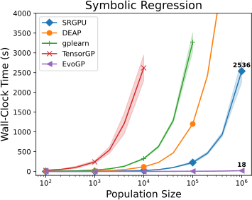

<h1 align="center">
  <a href="https://github.com/EMI-Group/evox">
  <picture>
    <source media="(prefers-color-scheme: dark)" srcset="./imgs/evox_brand_light.svg">
    <source media="(prefers-color-scheme: light)" srcset="./imgs/evox_brand_dark.svg">
    
  </picture>
  </a>
  <br>
</h1>

<p align="center">
  <picture>
    
  </picture>
</p>

<p align="center">
🌟 EvoGP 1.0-alpha — tree-based genetic programming on the EvoX Compiler, torch-free 🌟
</p>

<p align="center">
  <a href="https://arxiv.org/abs/2501.17168">
    
  </a>
</p>

## What EvoGP 1.0-alpha is

EvoGP is a **tree-based genetic programming** (TGP) framework for symbolic regression, the GP layer of the
[EvoX](https://github.com/EMI-Group/evox) family and the subject of the paper at
<https://arxiv.org/abs/2501.17168>; EvoX 2.0 ships no tree / GP / symbolic-regression component of its own.

`1.0.0a1`, released as **EvoGP 1.0-alpha**, is a **single-stack release**: the engine the package ships is
`evogp.gp`, a torch-free functional GP engine built on **EvoX Compiler** ([`evoxc`](https://pypi.org/project/evoxc/))
graphs plus numpy host glue, written in the EvoX 2.0 idiom — frozen config dataclasses holding static leaves only,
state as constant-shape tensors (`GPState(opcode, payload, size, fitness, key)`), plain module-level functions
(`init_gp`, `step`, `run`) and **key-based determinism**: the RNG is an `evoxc` splitmix64 key carried in the state,
so `run(..., key=0)` reproduces a run from one integer — no global seed, no `torch.manual_seed`, no torch at all.

Generation, the operator layer (selection, crossover, mutation and the elite splice in ONE traced graph per
generation) and evaluation are JIT-compiled through `evoxc`, and the **objective is the only plug-in point**: any
callable `channels -> (pop_size,) float32` that is MAXIMIZED, with every non-finite entry mapped to `-inf`. Two
optional satellites sit beside the engine, and neither is imported by `evogp.gp` — `evogp.fused`, the device-native
**Triton** evaluator (the `fused` extra; it is the one subtree of the package that imports `torch` at module scope,
so `import evogp.fused` needs that extra, while `triton` stays lazy inside `fused/kernels.py`), and
`evogp.evox_ext`, which presents the stack as an `evox.core.StdWorkflow` algorithm + problem pair. The only JIT
outside `evoxc` is Triton's, paid once at the fused route's first call; there is no build step.

EvoGP 1.0 replaces the pre-1.0 torch-native stack; the next two sections say what the new engine is and how it
compares with what it replaced.

## New in 1.0: the evoxc engine

Everything that used to be a torch module is now a traced `evoxc` graph plus numpy glue. In one page:

- **One stack.** `evogp.gp` is the whole engine — config, encoding, operators, problems and the driver live in one
  package, over one population encoding. `evogp.fused` and `evogp.evox_ext` are satellites, and the engine imports
  neither.
- **`evoxc` does the JIT.** Selection, crossover, mutation and the elite splice are traced into one graph per
  generation. Evaluation is one of three routes over the same population: a vectorized numpy pass, an `evoxc` graph
  compiled once per shape (`GraphEvaluator`), or a Triton kernel (`evogp.fused`). `evoxc` compiles at call time and
  Triton's JIT is paid once at the fused route's first call — there is no build step anywhere.
- **Three channel tensors instead of tree objects.** A population is three prefix-order `[pop_size, max_nodes]`
  arrays: `opcode` int32 (a `Func` id on a function node, an `NType` marker on a leaf), `payload` float32 (the
  constant or the variable index) and `size` int32 (the subtree size). Node 0 is the root, only
  `[0, size[:, 0])` is live, and children are addressed `c1 = i + 1`, `c2 = c1 + size[c1]`, `c3 = c2 + size[c2]`.
- **The route is an argument.** `evaluate=` is the objective — host numpy, the in-graph `iree` route, or the fused
  Triton kernel — and `backend=` / `device=` on the driver choose where the rest of the generation runs. Nothing
  switches routes behind the API.
- **Determinism is a key.** The RNG is an `evoxc` splitmix64 key that lives in `GPState.key` and is advanced there,
  so `run(config, evaluate, generations=..., key=0)` reproduces a whole run from one integer. There is no global
  seed and no `torch.manual_seed` in the reachable stack.
- **The import contract is torch-free.** `import evogp.gp` with `PYTHONPATH=src` alone pulls neither `torch`,
  `evox` nor `evoxc` at module scope: `evoxc` is imported at call time (and raises a `RuntimeError` that names the
  fix), `evogp.fused` is reached only through an in-function import, and `evox` is imported only by
  `evogp.evox_ext`.
- **The objective is the only plug-in point.** Any callable `channels -> (pop_size,) float32` that is MAXIMIZED,
  with every non-finite entry mapped to `-inf`; the driver never mutates the array a caller returns. `CustomLoss`
  is the escape hatch when a loss is easier to write than a fitness.

## New engine vs the old torch stack

The pre-1.0 torch-native stack (`evogp.tree` / `evogp.algorithm` / `evogp.problem` / `evogp.pipeline`) is deleted
from this release and recoverable at commit `6720723`. Side by side:

| | EvoGP 1.0 (`evogp.gp`) | pre-1.0 torch-native stack |
|---|---|---|
| architecture | one stack: `evogp.gp`, with `evogp.fused` and `evogp.evox_ext` as optional satellites it never imports | two stacks: the torch-native `evogp.tree` / `evogp.algorithm` / `evogp.problem` / `evogp.pipeline` modules over a `Forest` container, with kernel-era paths beside them |
| population | three `[pop_size, max_nodes]` channel tensors — int32 `opcode`, float32 `payload`, int32 `size` — in prefix order | `Forest` / `Tree` Python objects with a per-tree node protocol (`CombinedForest`, `GenerateDescriptor`, …) |
| determinism | `run(..., key=0)`: an `evoxc` splitmix64 key in `GPState.key`, advanced once per generation | `torch.manual_seed(0)` and the global torch RNG stream |
| route selection | the `evaluate=` argument, plus `backend=` / `device=` on the driver | the `EVOGP_EVAL_MODE` policy (`auto` / `dense` / `specialized` / `batch` / `fused`) with its `EVOGP_DENSE_*` / `EVOGP_BATCH_*` / `EVOGP_FUSED_MIN_POP` companions |
| dependencies | `evoxc` + numpy hard; extras `fused` (torch + triton), `iree`, `evox`, `dev`, `examples` | a torch + numpy stack; the `torch`, `brax` and `visualize` extras are removed |
| import cost | `import evogp.gp` pulls neither `torch`, `evox` nor `evoxc` at module scope; `import evogp.fused` is the one module-scope torch import, behind the `fused` extra | importing the GP modules imported torch |
| whole generation | **1.83×–2.31× faster** than the old default pipeline (1.319 → 1.453 ms against 2.573 → 3.403 ms), and 1.69×–2.34× against it with its fused kernel enabled: selection/crossover/mutation on one traced graph is 3.2×–3.9× cheaper (2.185–2.948 ms → 0.589–0.753 ms; 3.2×–4.9× in-graph, 0.500–0.917 ms) | 2.573 → 3.403 ms per generation with its fused kernel enabled |
| fused objective, per call | 0.6257–0.7286 ms — **9.0×–19.8× dearer** than the old pre-bound kernel, because every call exports three channels and fences once | 0.0341–0.0808 ms `batch_forward` on the same trees |
| not in this release | no sympy / infix / PNG exporter, no `Forest`-like population container, single-output only, symbolic regression only | — |

**The win is the loop, not the raw forward.** A whole generation on one traced operator graph is 1.83×–2.31× the
old default pipeline and 1.69×–2.34× its fused route, because selection, crossover and mutation cost 0.589–0.753 ms
on the fused route (0.500–0.917 ms in-graph) where the old operator layer cost 2.185–2.948 ms. The old stack's own
evaluation slice (0.377–0.469 ms) is in fact the cheaper one — what was removed is the operator overhead, not the
evaluator.

**The honest limit is per call.** The fused objective exports the three channels, converts them once and fences,
which makes it 9.0×–19.8× dearer than the old pre-bound `Forest` kernel on the same trees (0.6257–0.7286 ms against
0.0341–0.0808 ms `batch_forward`). Closing that gap is structural — a kernel that reads the channel layout
directly — not a faster conversion. Until then, the case for the new engine is the generation loop it replaces;
per-call `batch_forward` belongs to the old stack. `src/evogp/gp/POPSCALE.md` is the report of record for both
claims, and `src/evogp/fused/FUSED.md` documents the fused route's own envelope.

**The migration is mechanical.** A `Forest` build becomes `init_population` / `init_gp`, `GeneticProgramming` +
`StandardPipeline` become `step` / `run`, the `EVOGP_EVAL_MODE` environment becomes the `evaluate=` you pass, and
`torch.manual_seed` becomes `key=`. The migration section below lists the removed names one by one. What did not
change is the algorithm (tournament selection, subtree / point / hoist mutation, elitism), the fitness contract
(maximized, non-finite mapped to `-inf`) and the problem layer's scope (symbolic regression).

## Installation

```bash
pip install --pre "evogp==1.0.0a1"
```

The `--pre` flag matters: EvoGP 1.0 is a pre-release (`1.0.0a1`, EvoGP 1.0-alpha), so a plain `pip install evogp`
does not resolve it. `evoxc` (EvoX Compiler) is the one hard runtime dependency, with numpy for the host glue —
nothing else is imported by `evogp.gp`. The distributions are pure Python, built with the `uv_build` backend
(`uv build`), so there is no build step for users; a checkout needs only `PYTHONPATH=src`, with `evoxc` importable
at call time.

| extra | installs | needed for |
|---|---|---|
| `fused` | `torch`, `triton` | `evogp.fused` / `FusedDeviceEvaluator`. Needs a CUDA/HIP device and a **writable `TRITON_CACHE_DIR`** |
| `iree` | `iree-base-compiler`, `iree-base-runtime` (~3.11.x) | the `iree` backend of `GraphEvaluator` (the in-graph device route) |
| `evox` | `evox>=2.0.0a1` | `evogp.evox_ext` — the only subtree that imports `evox` (GPL-3.0-or-later) |
| `dev` | `pytest` | the three test suites |
| `examples` | `scikit-learn` | `example/gp_uci_sr.py` only (its bundled `load_diabetes` table) |

```bash
pip install --pre "evogp[fused,iree,evox,dev]==1.0.0a1"
```

## Quick Start

Symbolic regression on `x0**2 + x1**2`, 800 rows, pop 256 × 40 generations, on a CPU box with numpy alone:

```python
import numpy as np
from evogp.gp import GPConfig, GPTreeConfig, SymbolicRegression, row_length, run

rng = np.random.default_rng(0)
x = rng.uniform(-5, 5, size=(800, 2)).astype(np.float32)
y = (x[:, 0] ** 2 + x[:, 1] ** 2).astype(np.float32)

config = (
    GPTreeConfig(max_nodes=64, input_len=2, using_funcs=("+", "-", "*", "/"),
                 max_layer_cnt=4, const_range=(-5, 5), sample_cnt=8),
    GPConfig(pop_size=256, elite_count=2, tournament_size=4,
             crossover_prob=0.9, mutation_prob=0.2, mutation_kind="subtree"),
)
result = run(config, SymbolicRegression(x, y).evaluate, generations=40, key=0)
print("best fitness", f"{result.best_fitness:+.5f}",
      "at generation", result.best_generation,
      "| winner", int(row_length(result.best_channels)[0]), "nodes")
```

```
best fitness -0.00000 at generation 33 | winner 11 nodes
```

`-0.00000` is an exactly-zero mean squared error negated (a sign-of-zero cosmetic); the run takes ~2 s and a second
run prints the same numbers, because `key=0` is the whole determinism contract. The winner is
`GPResult.best_channels` — the three channel rows of a population of one, ready for `SymbolicRegression.predict`.
`example/gp_sr.py` is the same run with the full report (generation trace, node count, an infix rendering, RMSE),
`example/gp_custom_loss.py` covers `CustomLoss`, and `example/gp_device.py` shows the device routes of the next
section: `run(config, FusedDeviceEvaluator(x, y), generations=..., key=0, backend="iree", device=kind)` after an
`init_gp(config, 0, backend="iree", device=kind)`, gated by `fused_available()` and `interop_available(kind)`.

## Evaluation routes

Evaluation is a true JIT over `evoxc`, and there are exactly **three routes**. Unlike the pre-1.0 stack there is no
route policy behind the API: the route is whatever you pass as `evaluate=` (plus the `backend=` / `device=` of the
driver).

| route | how you select it | what runs | first call |
|---|---|---|---|
| **host numpy** — the reference | `SymbolicRegression(x, y).evaluate` / `CustomLoss` / `problem.predict` | one vectorized numpy pass over the whole population, on the CPU | nothing to compile |
| **in-graph `iree`** | `GraphEvaluator(x, y, used_ids=tree, backend="iree", device=kind)` | one compiled `evoxc` graph per shape, the whole evaluation traced in-graph; two graph runs per generation, zero readbacks | ~2.4–2.5 s per call, ~4.7–5.0 s per generation |
| **fused Triton** — device box only | `FusedDeviceEvaluator(x, y)` | ONE JIT-compiled Triton kernel launch per (tree, row block): channels cross via DLPack, the loss is reduced in-kernel into the `(pop_size,)` buffer the variation graph consumes; one fence, one graph run | ~0.87–0.92 s per call, ~3.2–3.5 s per generation |

### Measured numbers

`src/evogp/gp/POPSCALE.md` is the report of record for the population axis: one fixed acceptance shape (tree buffer
width 32, 8 inputs, 1 024 rows, depth cap 4), pop 64 → 8 192, every lane fed the SAME population, warm medians on an
AMD Instinct MI300X — measured on the pre-1.0 torch-native tree, whose torch comparison lanes went away with the
torch stack (recoverable at commit `6720723`).

| pop | numpy host (fitness) | in-graph `iree` (fitness) | fused Triton (fitness) | plain-torch batched (value) |
|---:|---:|---:|---:|---:|
| 64 | 2.8348 | 0.5742 | 0.6257 | 2.0043 |
| 512 | 17.9101 | 0.9832 | 0.7147 | 2.0947 |
| 1024 | 39.4831 | 1.5378 | 0.6103 | 2.3405 |
| 8192 | 528.9067 | 10.9865 | 0.7286 | 7.7796 |

ms per call at that shape. The three `evogp` columns are the maximized-fitness surface the driver consumes; the torch
arm is its whole-population value forward, the quantity the record's own ratios (§1.3) are quoted against.

- **The fused route is flat** — 1.16× for 128× the population — so its multiple over the plain-torch batched
  evaluator **grows** from 3.20× at pop 64 to 10.68× at pop 8 192 (29.8×–481.9× the per-tree torch walk,
  4.53×–725.9× the numpy host path). **A whole `evogp.gp` generation is 1.83×–2.31× faster than the torch stack's
  default pipeline and 1.69×–2.34× faster than it with its own fused kernel enabled** (1.319 → 1.453 ms against
  2.573 → 3.403 ms): the operator layer is one traced graph and 3.2×–3.9× cheaper, while the torch stack's
  evaluation slice is in fact the cheaper one (0.377–0.469 ms).
- **The in-graph route is the small-population and torch-free choice**: cheapest generation up to pop 256, but it
  crosses the plain-torch batched evaluator between pop 1 024 (1.52× ahead) and 2 048 (1.12× behind), since its cost
  is `pop × rows` child reads.
- **The honest limit:** per call the fused objective is **9.0×–19.8× dearer** than the deleted torch stack's own
  pre-bound fused route on the same trees (0.0341–0.0808 ms `batch_forward`), because it pays a crossing — three
  channel exports, the legacy-triple conversion in torch, one fence — that the old stack did not pay. **The win is
  the loop, not the raw forward** (record §1.4/§5(a)). Set `EVOXC_DISABLE_LOCATIONS=1` for real runs: it speeds
  `evoxc` tracing up ~4×.

## API overview

`import evogp` is deliberately empty: every import goes through a submodule.

**`evogp.gp`** — the engine. *Config*: `GPTreeConfig` (tree buffer width, inputs, function set with weights, depth
schedule, leaf/const probabilities, the constant table), `GPConfig` (population, elitism, selection and mutation
rates), `SELECTION_MODES`, `MUTATION_KINDS`. *State*: `GPState`, `channels`, `replace`, `population_size`,
`max_nodes`, `CHANNEL_NAMES`, `UNEVALUATED`. *Encoding*: `init_population`, `live_mask`, `row_length`, `is_leaf`,
`validate_channels`, `to_legacy_triple` / `from_legacy_triple` (the bridge to the kernel's `(value, type, size)`
layout). *Operators*: `select`, `apply_crossover`, `mutate`, `point_mutation`, `subtree_mutation`, `hoist_mutation`,
`apply_variation`. *Problems*: `BaseProblem`, `SymbolicRegression` (MSE or MAE), `CustomLoss`, `predict`,
`predict_graph`, `sr_fitness_graph`. *Device*: `GraphEvaluator`, `sr_fitness_channels`, `readback_fitness`,
`FusedEvaluator`, `FusedDeviceEvaluator`, `fused_available()`, `interop_available(kind)`. *Driver*: `init_gp`,
`step`, `run`, `GPResult` (best/median fitness history, `best_channels`, `best_generation`, `state`) — `run`'s only
per-generation hook is `callback(generation, state, fitness)`. *Cache*: `cache_stats()`, `clear_cache()`. Knobs:
`EVOGP_GP_COMPILE_CACHE_SIZE` (64), `EVOGP_GP_GRAPH_CACHE_SIZE` (32), `EVOGP_GP_EVAL_BUDGET_MB` (256).

**`evogp.fused`** — the device route: `evaluate_fused`, `sr_fitness_fused`, `envelope_decline`, `fused_available`,
`fused_cache_stats`, `clear_fused_cache`, `FusedUnsupported`, `MAX_OUT_LEN` (8), the geometry resolvers
(`resolve_block_rows` / `resolve_num_warps` / `resolve_max_scratch_mb` / `resolve_dispatch`) and the `kernels`
submodule. It never chooses itself: a declined call raises `FusedUnsupported` with the reason and **the caller owns
the fallback**. Knobs: `EVOGP_FUSED_BLOCK_ROWS` (256), `EVOGP_FUSED_NUM_WARPS` (1), `EVOGP_FUSED_MAX_SCRATCH_MB`
(8192), `EVOGP_FUSED_DISPATCH` (`bound`), `EVOGP_FUSED_HOST_MEMO` (16). Its in-library battery:

```bash
python -m evogp.fused.check --stage all   # parity | multi | goldens | declines | timing | tuning
```

**`evogp.evox_ext`** — the EvoX 2.0 adapter: `GPAlgorithmConfig` / `make_gp_algorithm`, `SRProblemConfig` /
`SRProblemState` / `make_sr_problem`, `make_stdworkflow(algorithm, problem, backend=, device=, cache_dir=)` — which
fixes `opt_direction="max"`, refuses any other orientation and forwards `StdWorkflow(cache_dir=...)` when the
installed `evox` declares it — and the readbacks `generation_fitness`, `best_so_far`, `best_row`, `host_channels`.
Runnable demo: `python -m evogp.evox_ext.demo_stdworkflow` (`--backend iree --device rocm:0` on a device box).

## Migrating from the old torch-based evogp (pre-1.0)

`1.0.0a1` deletes the pre-1.0 torch-native stack. This is the complete list of what changed.

**Removed, with no shims**

- The modules `evogp.tree`, `evogp.algorithm`, `evogp.problem`, `evogp.pipeline`, `evogp.sr_test` and
  `evogp.tests` are gone — `from evogp.tree import ...` now raises `ModuleNotFoundError`.
- `Forest`, `Tree`, `CombinedForest`, `GenerateDescriptor`, `GeneticProgramming`, `StandardPipeline`,
  `DefaultSelection`, `DefaultMutation` and `SympyExpression` no longer exist.
- The route-policy environment variables are gone: `EVOGP_EVAL_MODE` (with its `auto` / `dense` / `specialized` /
  `batch` / `fused` spellings), `EVOGP_DENSE_*`, `EVOGP_EVOXC_*`, `EVOGP_BATCH_*` and `EVOGP_FUSED_MIN_POP`.
  Nothing switches routes behind a call any more; the route is the `evaluate=` argument you pass.
- Determinism moved from `torch.manual_seed(0)` to `run(..., key=0)`: the RNG stream lives in `GPState.key` and is
  advanced there (`GPState.key` is the key of the NEXT generation).
- The `torch`, `brax` and `visualize` extras are gone (`fused`, `iree`, `evox`, `dev`, `examples` replace them),
  and `scikit_learn` / `networkx` / `sympy` are no longer dependencies.

**Feature gaps carried forward**

- **Single-output only**: `init_population` raises `NotImplementedError` for `output_len > 1`, and every evaluator
  refuses an `OUT_NODE`-tagged population. `CustomLoss` is the escape hatch, including for a multi-output fitness.
- **Symbolic regression is the whole problem layer**: no classification, transformation or robotics problems.
- **No export**: nothing renders a tree to sympy, to an infix string or to a PNG — the winner leaves the stack as
  the three channel rows of `GPResult.best_channels` (`example/gp_sr.py` carries a ~30-line local renderer).
- **No population container**: no `Forest`-like object protocol over a population; the population IS the three
  channel rows.

**Recovery pointer**: the pre-1.0 torch-native stack is recoverable at commit `6720723` (`git checkout 6720723`),
whose README documents its API and whose `example/` carries the paper's experiment scripts.

## Repository layout

```
src/evogp/gp/        the torch-free functional GP engine (config, state, encoding, operators,
                     problems, GraphEvaluator, fused_eval, the driver, the smoke run, the
                     measurement harnesses and POPSCALE.md / DEVICE_LOOP.md)
src/evogp/fused/     the optional Triton route (engine, kernels, memo, the `check` battery, FUSED.md)
src/evogp/evox_ext/  the EvoX 2.0 `StdWorkflow` adapter (the only subtree that imports `evox`)
src/evogp/           _tables.py (node/function ids) and _multi_output.py (the OUT_NODE rule)
example/             five runnable scripts: gp_sr, gp_custom_loss, gp_uci_sr, gp_device, evox_workflow
tutorial/            gp_intro.ipynb — the same walkthrough as a notebook, with stored outputs
test/                dev tooling, not a suite: oracle/ (the plain-torch numeric oracle and its
                     goldens), goldens/ (frozen legacy captures), benchmark/ (historical campaigns)
pyproject.toml       packaging: the uv_build backend, version, extras and package data
.github/workflows/   release.yml — tag ↔ version check, CPU test gate, uv build, wheel smoke
                     install and PyPI Trusted Publishing on a published GitHub Release
```

## Validation

Run from the repository root with `evoxc` on the path (plus `/path/to/evox/src` for the adapter) and a writable
`TRITON_CACHE_DIR` if you touch the fused route:

```bash
export EVOXC_DISABLE_LOCATIONS=1 TRITON_CACHE_DIR=/tmp/triton_cache_evogp
export PYTHONPATH=src:/path/to/evoxc:/path/to/evox/src
mkdir -p "$TRITON_CACHE_DIR"

# 1. the three suites — quote them per path, not as a sum
python -m pytest src/evogp/gp/tests -q         # 349 passed / 0 skipped (device reference box)
python -m pytest src/evogp/fused/tests -q      #  45 passed / 0 skipped
python -m pytest src/evogp/evox_ext/tests -q   #  13 passed

# 2. the converging CPU smoke (numpy only, no device, ~4 s)
python -m evogp.gp.smoke                       # -0.27225 -> -0.10690, best tree 57 nodes

# 3. the fused route's numeric / contract / measurement battery
python -m evogp.fused.check --stage all        # parity 56/56, multi 65/65, goldens 10/10,
                                               # declines 58/58, then the timing and tuning grids
```

The packaging check builds the distributions with `uv build` and smoke-installs the wheel outside the checkout:

```bash
uv build                                       # dist/evogp-1.0.0a1-py3-none-any.whl + sdist
python -m venv "$TMPDIR/evogp-wheel"
"$TMPDIR/evogp-wheel/bin/pip" install dist/evogp-1.0.0a1-py3-none-any.whl evoxc
cd "$TMPDIR" && "$TMPDIR/evogp-wheel/bin/python" -m evogp.gp.smoke
```

The device-gated `test_gp_stack_device_*` modules SKIP (never fail) where `iree`, a visible device, torch/triton or
`evoxc`'s DLPack export is missing, as do `fused/tests` on a CPU-only or triton-less box and `evox_ext/tests`
without `evox` on the path. Coverage gaps are listed in `src/evogp/CONTEXT.md`.

## Releasing

The release pipeline is `.github/workflows/release.yml`, and it triggers on a **published GitHub Release**.

1. Set the version in `pyproject.toml` (and the README / `CHANGELOG.md` headers with it), then commit.
2. Tag the release and push the tag: `git tag v1.0.0a1 && git push origin v1.0.0a1`.
3. Draft a GitHub Release from that tag, mark it **Pre-release**, and publish it.

On publication the workflow verifies the tag against the version in `pyproject.toml`, runs the CPU test gate (the
three suites quoted per path, plus the smoke), builds the wheel and sdist with `uv build`, smoke-installs the wheel
in a clean environment, publishes to PyPI through **Trusted Publishing** (OIDC, no API token in the repository) and
attaches the distributions to the Release. A version mismatch, a failing test or a failed smoke install stops the
job before anything reaches PyPI.

## Citation

If you use EvoGP in your research, please cite *EvoGP: A GPU-accelerated Framework for Tree-based Genetic
Programming* (Wu, Wang, Sun and others, arXiv:2501.17168, 2025) — see
<https://arxiv.org/abs/2501.17168> for the BibTeX entry. EvoGP is a sister project of
[EvoX](https://github.com/EMI-Group/evox).

## Licence

Apache License 2.0 (see [`LICENSE`](LICENSE)). `evox` 2.0 is GPL-3.0-or-later and is required only by the optional
`evogp.evox_ext` adapter; no other module of EvoGP imports it.
